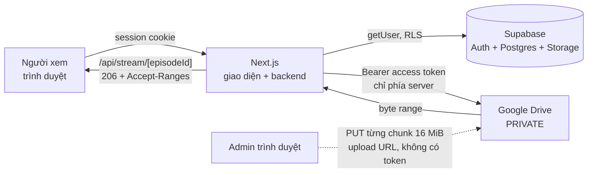

# Phim Web — web xem phim riêng tư (Next.js + Supabase + Google Drive)

Web xem phim nội bộ cho ~10 người. File MP4 nằm trên **Google Drive riêng tư** của chủ hệ thống; website chỉ lưu metadata và ID file, rồi **proxy stream (hỗ trợ HTTP Range)** từ Drive tới người xem sau khi kiểm tra đăng nhập.

> Chỉ dùng cho nội dung mà bạn có quyền lưu trữ và chia sẻ.

## Kiến trúc



| Thành phần | Vai trò |
|---|---|
| **Google Drive** | Nơi chứa file MP4. **Không phải database.** Folder không bao giờ public. |
| **Supabase** | Tài khoản, metadata phim, tiến độ xem, yêu thích, nhật ký, ảnh poster/phụ đề. |
| **Next.js** | Giao diện + backend (route handler, Node runtime). |
| **`/api/stream/[episodeId]`** | Cổng bảo vệ phim: kiểm tra đăng nhập → tra `episodeId` → lấy file ID từ DB → proxy Range từ Drive. Client **không bao giờ** gửi file ID. |

### Băng thông VPS

Mọi lượt xem đi **Drive → VPS → người xem**, nên VPS gánh cả băng thông xuống lẫn lên.

| Chất lượng | Mỗi người xem | 10 người cùng lúc |
|---|---|---|
| 720p | ≈ 3–5 Mbps | 30–50 Mbps |
| 1080p | ≈ 5–10 Mbps | **50–100 Mbps** |
| 4K | ≈ 20–40 Mbps | 200–400 Mbps |

Hãy chọn VPS có đường truyền ≥ 100 Mbps *đối xứng* và quota băng thông đủ lớn (1 giờ 1080p ≈ 2–4 GB mỗi người). `MAX_CONCURRENT_STREAMS` (mặc định 15) và `MAX_STREAMS_PER_USER` (mặc định 3) giới hạn tải. Drive cũng có hạn mức tải xuống theo file/ngày (`downloadQuotaExceeded`); admin sẽ thấy chi tiết lỗi này khi phát.

---

## Việc bạn phải tự làm (không thể tự động hóa)

1. Tạo project **Supabase** và chạy migration (mục 3).
2. Tạo project **Google Cloud**, bật Drive API, tạo OAuth Client (mục 4).
3. Tạo folder `PHIM_WEB` trên Drive và lấy Folder ID.
4. Điền `.env`.
5. (Production) VPS, domain, HTTPS (Let's Encrypt), Nginx, Docker.

## Chạy local từng bước

Yêu cầu: Node.js ≥ 20.19 (đã thử với Node 24), npm.

### 1. Clone và cài đặt

```bash
git clone <repo-url> phim-web && cd phim-web
npm install
```

### 2. Tạo `.env.local`

```bash
cp .env.example .env.local
openssl rand -base64 32      # dán kết quả vào APP_ENCRYPTION_KEY
```

Điền các biến theo bảng dưới. **Không bao giờ commit `.env*`** (đã nằm trong `.gitignore`).

| Biến | Lấy ở đâu |
|---|---|
| `NEXT_PUBLIC_APP_URL` | `http://localhost:3000` (local) hoặc `https://domain.com` |
| `NEXT_PUBLIC_SUPABASE_URL`, `NEXT_PUBLIC_SUPABASE_ANON_KEY` | Supabase → Project Settings → API |
| `SUPABASE_SERVICE_ROLE_KEY` | cùng trang (**bí mật**, chỉ phía server) |
| `GOOGLE_CLIENT_ID`, `GOOGLE_CLIENT_SECRET` | Google Cloud → Credentials (mục 4) |
| `GOOGLE_REDIRECT_URI` | `http://localhost:3000/api/google/callback` |
| `GOOGLE_DRIVE_ROOT_FOLDER_ID` | Phần cuối URL folder `PHIM_WEB` (mục 5) |
| `APP_ENCRYPTION_KEY` | 32 byte base64, mã hóa refresh token (AES-256-GCM) |
| `TMDB_API_KEY` | Tùy chọn. Bật gợi ý metadata TMDB khi thêm phim |

### 3. Supabase: migration và cấu hình Auth

1. Supabase → **SQL Editor** → chạy lần lượt các file trong [supabase/migrations/](supabase/migrations/):
   `0001_schema.sql` → `0002_rls.sql` → `0003_seed_and_triggers.sql`
   (hoặc `supabase db push` nếu dùng Supabase CLI). Migration tạo bảng, index, RLS, hàm `is_admin()`, chặn user tự sửa `role`/`is_active`, seed 14 thể loại và bucket Storage `media`.
2. **Tắt đăng ký công khai**: Authentication → Sign In / Providers → Email → tắt **Allow new users to sign up** (hoặc *Authentication → Settings → Disable sign ups*). Tài khoản chỉ được tạo bởi admin.
3. (Khuyến nghị) Authentication → Email: tắt "Confirm email" không cần thiết vì admin tạo user đã xác nhận sẵn.

### 4. Google Cloud (OAuth, **không** dùng Service Account)

Service Account không có dung lượng Drive riêng nên không upload vào Drive cá nhân được, vì vậy dự án dùng OAuth.

1. https://console.cloud.google.com → tạo project mới.
2. **APIs & Services → Library** → bật **Google Drive API**.
3. **OAuth consent screen**: loại *External*, điền tên app + email. Thêm scope `.../auth/drive`.
4. ⚠️ **Chuyển Publishing status sang _In production_.**
   Nếu để ở **Testing**, **refresh token hết hạn sau 7 ngày** và Drive sẽ tự mất kết nối. App chưa verify vẫn dùng được cho cá nhân (chỉ hiện màn hình cảnh báo "Google hasn't verified this app" → *Advanced → Go to … (unsafe)*).
5. **Credentials → Create credentials → OAuth client ID → Web application**. Thêm *Authorized redirect URIs*:
   - `http://localhost:3000/api/google/callback`
   - `https://domain.com/api/google/callback`
6. Copy Client ID / Client Secret vào `.env.local`.

Scope là `drive` (không phải `drive.file`) vì `drive.file` chỉ thấy file do chính app tạo, không liên kết được file có sẵn. Google không giới hạn quyền theo folder, nên code tự kiểm tra: mọi thao tác đọc/link/upload/xóa đều đi qua `assertInsideRoot(fileId)` — file phải nằm dưới `GOOGLE_DRIVE_ROOT_FOLDER_ID`.

### 5. Folder gốc trên Drive

Tạo folder `PHIM_WEB` trong Google Drive. Mở folder, URL có dạng `https://drive.google.com/drive/folders/1AbC...xyz` → phần `1AbC...xyz` là `GOOGLE_DRIVE_ROOT_FOLDER_ID`. **Để folder ở chế độ Restricted** (không "Anyone with the link").

Cấu trúc tự tạo khi upload: `PHIM_WEB/movies/{slug}/` và `PHIM_WEB/series/{slug}/season-01/`. ID folder được lưu, không dựa vào tên.

### 6. Tạo admin, chạy, kết nối Drive

```bash
npm run create-admin     # nhập email, mật khẩu, tên (mật khẩu không được lưu dạng plain)
npm run dev              # http://localhost:3000
```

Đăng nhập → biểu tượng ⚙ → **Cài đặt → Kết nối Google Drive** → đăng nhập Google bằng tài khoản chứa folder → **Test connection** phải báo "Google Drive hoạt động bình thường."

### Lệnh hay dùng

```bash
npm run dev          # chạy dev
npm run verify       # typecheck + lint + test + build
npm run test         # unit + integration (Vitest)
npm run test:e2e     # Playwright (xem biến E2E_* bên dưới)
npm run create-admin # tạo / nâng quyền admin
```

E2E cần Supabase thật: đặt `E2E_ADMIN_EMAIL/PASSWORD`, `E2E_USER_EMAIL/PASSWORD`, `E2E_MOVIE_SLUG` (phim đã publish có 1 tập). Thiếu biến thì các test tương ứng tự bỏ qua; các test đăng nhập/chặn truy cập chạy được không cần dữ liệu.

---

## Cách dùng (admin)

| Việc | Ở đâu |
|---|---|
| Tạo phim (có thể điền tự động từ TMDB) | Admin → Phim → Thêm phim |
| Thêm file **có sẵn** trên Drive | Admin → Google Drive → duyệt folder → *Thêm vào thư viện* |
| Upload file lớn (resumable) | Admin → Tải lên |
| Đồng bộ Drive ↔ DB | Admin → Google Drive → *Đồng bộ với DB* (chỉ đặt `missing`, không tự xóa) |
| Phụ đề (.vtt/.srt) | Admin → Phim → Các tập → biểu tượng phụ đề |
| Tạo/khóa user, đổi quyền, reset mật khẩu | Admin → Người dùng |
| Nhật ký thao tác | Admin → Nhật ký |

Phim chỉ hiện cho người xem khi **phim `published`** *và* tập `published`. Xóa phim mặc định chỉ xóa khỏi thư viện; "Xóa cả file trên Drive" cần xác nhận lần hai và chuyển file vào thùng rác Drive.

### Faststart (khởi động và tua nhanh)

MP4 phải có atom `moov` ở **đầu** file thì trình duyệt mới bắt đầu phát/tua ngay mà không tải hết file. Khi liên kết/upload, hệ thống đọc ~512 KB đầu bằng Range để kiểm tra và cảnh báo nếu chưa faststart. Sửa **không cần encode lại**:

```bash
ffmpeg -i in.mp4 -c copy -movflags +faststart out.mp4
```

Định dạng: MP4 (H.264 + AAC) là chuẩn. WebM/MKV/AVI được phép nhưng hiện cảnh báo "Định dạng này có thể không tương thích với trình duyệt." Không transcoding.

---

## Triển khai production (VPS + Docker + Nginx)

```bash
# 1) Trên VPS
git clone <repo-url> /opt/phim-web && cd /opt/phim-web
cp .env.example .env && nano .env            # NEXT_PUBLIC_APP_URL=https://domain.com ... ; GOOGLE_REDIRECT_URI=https://domain.com/api/google/callback
chmod 600 .env

# 2) Build + chạy (secret nạp lúc runtime qua env_file, không bake vào image)
docker compose up -d --build
docker compose logs -f web
curl -s http://127.0.0.1:3000/api/health      # {"app":"ok","db":"ok"}

# 3) Tạo admin (chạy script bằng Node trên máy bạn hoặc trong repo có .env)
npm ci && npm run create-admin

# 4) Nginx + HTTPS
sudo cp deploy/nginx.conf /etc/nginx/sites-available/phim-web   # sửa domain
sudo ln -s /etc/nginx/sites-available/phim-web /etc/nginx/sites-enabled/
sudo certbot --nginx -d domain.com
sudo nginx -t && sudo systemctl reload nginx

# Cập nhật phiên bản mới
git pull && docker compose up -d --build
```

Cấu hình Nginx ([deploy/nginx.conf](deploy/nginx.conf)) bắt buộc HTTPS; riêng `/api/stream/` tắt `proxy_buffering`/`proxy_request_buffering`, `proxy_read_timeout`/`proxy_send_timeout` 3600s, chuyển tiếp `Range`/`If-Range` và không cache. **Không dùng serverless** cho stream (cần tiến trình Node chạy lâu); rate limit và bộ đếm stream nằm trong bộ nhớ nên chạy **1 instance**.

Nhớ thêm `https://domain.com/api/google/callback` vào *Authorized redirect URIs* của OAuth client. `NEXT_PUBLIC_*` được nhúng lúc build: đổi domain/Supabase URL thì phải `docker compose up -d --build` lại.

---

## Checklist 1 — Xác minh Drive là PRIVATE

- [ ] Folder `PHIM_WEB` → *Share*: General access = **Restricted** (không "Anyone with the link").
- [ ] Mở thử một file ở cửa sổ ẩn danh bằng link Drive → bị chặn / yêu cầu đăng nhập.
- [ ] Trong code không có `permissions.create` với `type: anyone`: `grep -rn "anyone" src` → không có kết quả.
- [ ] Không có `<iframe>` Drive hay link `drive.google.com/file/d/...preview` trong HTML trang xem (xem Network: video chỉ gọi `/api/stream/<uuid>`).
- [ ] Trang watch: `<video src>` là `/api/stream/<episodeId>`; không thấy file ID, access token hay refresh token trong HTML, response API, localStorage, cookie (Application tab).
- [ ] `curl -I https://domain.com/api/stream/<uuid>` khi chưa đăng nhập → **401**.
- [ ] Bảng `drive_integrations` không đọc được bằng anon key: `curl "$SUPABASE_URL/rest/v1/drive_integrations" -H "apikey: $ANON"` → lỗi permission denied / `[]`.
- [ ] Refresh token trong DB bắt đầu bằng `v1.` (đã mã hóa), không phải `1//...`.

## Checklist 2 — Test playback

- [ ] Phim MP4 faststart: bấm Play < 3 giây ở kết nối tốt.
- [ ] Tua tới giữa/cuối phim: phát lại nhanh; Network hiện `206 Partial Content` + `Content-Range`.
- [ ] `curl -s -o /dev/null -D- -H "Cookie: <session>" -H "Range: bytes=0-999999" https://domain.com/api/stream/<uuid>` → `206`, `Accept-Ranges: bytes`, `Content-Range: bytes 0-999999/<size>`, `Content-Type: video/mp4`, `Cache-Control: private, no-store`.
- [ ] `Range: bytes=5000000-6000000` → đúng 1.000.001 byte, trả về nhanh (không tải từ đầu).
- [ ] Range vượt cỡ file → `416` + `Content-Range: bytes */<size>`.
- [ ] Đóng tab giữa chừng: số kết nối Drive giảm (RAM VPS không tăng; theo dõi bằng `docker stats`).
- [ ] 4 tab cùng một user → tab thứ 4 nhận 429 + `Retry-After`.
- [ ] Phụ đề `.vtt` hiện và bật/tắt được; phím tắt Space, ←/→, F, M hoạt động; PiP (nếu trình duyệt hỗ trợ).
- [ ] "Tiếp tục từ mm:ss" đúng vị trí; hết tập có overlay "Tập tiếp theo bắt đầu sau 10 giây".
- [ ] Mobile (iOS Safari + Android Chrome): phát được, `playsInline`, giao diện 2 cột poster.
- [ ] Ngắt kết nối Drive trong Cài đặt: admin thấy "Google Drive đã mất kết nối. Vui lòng kết nối lại."; phần còn lại của web vẫn chạy.

## Checklist 3 — Security

- [ ] `grep -rn "NEXT_PUBLIC" src` chỉ có `APP_URL`, `SUPABASE_URL`, `SUPABASE_ANON_KEY`. `SUPABASE_SERVICE_ROLE_KEY`/`GOOGLE_CLIENT_SECRET` **không** có tiền tố `NEXT_PUBLIC_`.
- [ ] `grep -rl "SERVICE_ROLE\|CLIENT_SECRET" .next/static` → rỗng (bundle trình duyệt sạch).
- [ ] `src/lib/supabase/admin.ts` có `import "server-only"`.
- [ ] Supabase: đã **tắt signup**; RLS bật cho mọi bảng (`select tablename from pg_tables where schemaname='public' and not rowsecurity;` → rỗng).
- [ ] User thường truy cập `/admin` → bị chuyển về `/`; gọi `/api/admin/*` → 403.
- [ ] User bị khóa: không đăng nhập được và không gọi được API/stream.
- [ ] Không thể hạ quyền/khóa admin cuối cùng (409).
- [ ] Response có `Content-Security-Policy`, `X-Content-Type-Options: nosniff`, `Referrer-Policy`, `Permissions-Policy`; `media-src 'self'`.
- [ ] `.env`, key, token **không** nằm trong git: `git log -p | grep -i "service_role\|client_secret"` → rỗng.
- [ ] HTTPS bắt buộc; HSTS bật.
- [ ] `npm audit --omit=dev` không có lỗ hổng mức high/critical chưa xử lý.
- [ ] Log (`docker compose logs web`) không chứa mật khẩu, token, upload URL, key.

---

## Cấu trúc thư mục

```
src/app/(auth)/login        đăng nhập (không đăng ký)
src/app/(main)              trang người xem: home, movie, watch, search, favorites, genres
src/app/admin               dashboard, phim, thể loại, drive, tải lên, người dùng, nhật ký, cài đặt
src/app/api                 stream, progress, favorites, search, google, admin/*, health
src/proxy.ts                (Next 16: thay middleware) refresh session + chặn trang chưa đăng nhập
src/lib/google-drive        auth (token), oauth, client (googleapis), folders (assertInsideRoot), stream, upload, provider
src/lib/stream              handler Range, limiter, LRU cache, pipe có backpressure
src/lib/upload              giao thức resumable + uploader chạy trong trình duyệt
src/lib/{auth,supabase,crypto,validation,services,http,utils}
supabase/migrations         schema + RLS + seed
scripts/create-admin.ts     tạo admin
deploy/nginx.conf           cấu hình Nginx
tests/  e2e/                Vitest / Playwright
```

## Ghi chú kỹ thuật

- **Next.js 16.3.8** (pin cố định). File `middleware` đã đổi tên thành `proxy` ở v16 nên dự án dùng `src/proxy.ts`.
- Stream không buffer video trong RAM: dùng Web Stream có backpressure (`highWaterMark: 0`), hủy request tới Drive khi người xem đóng/tua (`request.signal`). Không dùng `arrayBuffer()`/`Buffer.from` trên video; chỉ đọc ~512 KB đầu file (bằng Range) để kiểm tra faststart.
- Quyền xem kiểm ở backend (`requireUser`/`requireAdmin`) **và** RLS. Trên đường nóng `/api/stream`, JWT được xác thực cục bộ (`getClaims`) và profile cache 30 giây; mọi nơi khác dùng `getUser()`.
- `admin` không sửa `role`/`is_active` qua client Supabase của chính họ: các thay đổi này đi qua service role phía server, có kiểm "admin cuối cùng" và ghi nhật ký.
- Poster/backdrop upload thủ công lưu ở Supabase Storage; ảnh chọn từ TMDB dùng trực tiếp URL `image.tmdb.org`.
- Rate limit và giới hạn stream lưu trong bộ nhớ tiến trình (đủ cho 1 instance).

## Xử lý sự cố

| Triệu chứng | Nguyên nhân thường gặp |
|---|---|
| "Google Drive đã mất kết nối" sau ~7 ngày | OAuth consent screen đang ở **Testing** → chuyển **In production**, rồi Reconnect |
| Google không trả refresh token | Thu hồi quyền app tại myaccount.google.com/permissions rồi Connect lại |
| Upload chunk bị CORS | Session phải tạo với header `Origin` = domain web (đã làm); kiểm tra `NEXT_PUBLIC_APP_URL` đúng domain đang dùng |
| Video khởi động chậm / tua chậm | MP4 chưa faststart (xem lệnh ffmpeg ở trên) |
| Phát lỗi "downloadQuotaExceeded" | File vượt hạn mức tải của Drive; thử lại sau hoặc nhân bản file |
| 429 khi xem | Vượt `MAX_STREAMS_PER_USER` / `MAX_CONCURRENT_STREAMS` |
| `/api/health` trả `db: error` | Sai `SUPABASE_URL`/`SERVICE_ROLE_KEY` hoặc chưa chạy migration |
